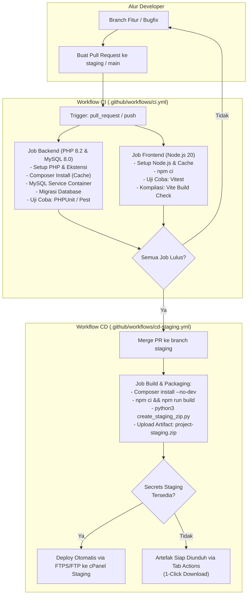

# Panduan Arsitektur & Alur Kerja Pipeline CI/CD

Dokumen ini menjelaskan rancangan, konfigurasi, dan alur kerja otomatisasi **Continuous Integration (CI)** dan **Continuous Deployment (CD)** pada repository `20-10-indonesia-strategy-forum`.

---

## 1. Diagram Alur Pipeline

---

## 2. Continuous Integration (CI)

Berkas konfigurasi: [`.github/workflows/ci.yml`](../.github/workflows/ci.yml)

### A. Kapan CI Dijalankan?
- Setiap kali ada **Push** ke branch `staging` atau `main`.
- Setiap kali ada **Pull Request (PR)** baru atau commit tambahan yang menargetkan `staging` atau `main`.
- Bisa juga dijalankan secara manual (*manual dispatch*) melalui tab **Actions** di GitHub.

### B. Tahapan Uji Backend (PHP 8.2 & MySQL 8.0)
1. **Container Service MySQL 8.0**: Dijalankan otomatis sebagai background service dengan database `wedding_db`.
2. **Environment PHP 8.2**: Dikonfigurasi dengan ekstensi lengkap (`mbstring`, `xml`, `pdo_mysql`, `bcmath`, `zip`, dll.).
3. **Dependency Caching**: Composer cache otomatis disimpan untuk mempercepat waktu eksekusi run berikutnya.
4. **Migrasi Database**: Menjalankan `php artisan migrate --force` untuk memastikan seluruh migration Laravel valid dan bebas error sintaks SQL.
5. **Test Suite Execution**: Menjalankan `php artisan test` (Pest / PHPUnit) untuk memastikan logika fitur dan otorisasi tidak mengalami regresi.

### C. Tahapan Uji Frontend (Node.js 20 & Vite)
1. **Environment Node.js 20**: Menggunakan clean runner dengan caching `npm`.
2. **Instalasi Bersih**: Menjalankan `npm ci` untuk mengunci konsistensi versi package sesuai `package-lock.json`.
3. **Unit & Flow Testing**: Menjalankan `npm test` (Vitest) untuk memastikan komponen antarmuka, routing, dan alur aplikasi bekerja sesuai spesifikasi.
4. **Production Build Validation**: Menjalankan `npm run build` untuk memverifikasi tidak ada chunk, syntax, atau template compiling error sebelum kode di-merge.

---

## 3. Continuous Deployment (CD) - Staging Release

Berkas konfigurasi: [`.github/workflows/cd-staging.yml`](../.github/workflows/cd-staging.yml)

### A. Kapan CD Dijalankan?
- Setiap kali ada merge Pull Request ke branch **`staging`**.
- Dapat dijalankan secara manual kapan saja dari tab **Actions** GitHub (`workflow_dispatch`).

### B. Proses Build & Pengemasan Otomatis
1. Runner mengunduh kode terbaru dari branch `staging`.
2. Dependensi PHP diinstal dengan mode produksi (`composer install --no-dev --optimize-autoloader`).
3. Aset antarmuka dikompilasi menggunakan Vite produksi (`npm ci && npm run build`).
4. Skrip pengemasan [`create_staging_zip.py`](../create_staging_zip.py) dieksekusi di cloud runner untuk menghasilkan paket berkas `project-staging.zip` yang sudah memuat:
   - File `.env` yang disalin otomatis dari `.env.staging`.
   - Direktori `vendor/` dan `public/build/` yang terkompilasi bersih.
   - Pengecualian otomatis terhadap `node_modules`, `.git`, file log, dan cache session lokal.
5. Paket hasil rilis diunggah ke **GitHub Actions Artifacts** dengan retensi selama **30 hari**.

### C. Cara Mengunduh Paket Rilis Staging
1. Buka tab **Actions** di repository GitHub: `https://github.com/reGardens/20-10-indonesia-strategy-forum/actions`.
2. Klik workflow run terbaru pada workflow **"CD - Staging Release & Automated Deployment"**.
3. Gulir ke bagian paling bawah ke seksi **Artifacts**.
4. Klik **`project-staging-release`** untuk langsung mengunduh `project-staging.zip`.
5. Unggah berkas ZIP tersebut ke cPanel File Manager staging lalu klik **Extract**.

---

## 4. Konfigurasi Deployment Langsung (Opsional / Direct Deploy)

Jika ingin mengaktifkan deployment otomatis langsung dari GitHub Actions ke server cPanel staging tanpa perlu upload ZIP manual:

Tambahkan kredensial berikut pada menu **Settings** -> **Secrets and variables** -> **Actions** di repository GitHub:

| Nama Secret | Deskripsi | Contoh Nilai |
|-------------|-----------|--------------|
| `STAGING_HOST` | Hostname / IP server hosting atau FTP | `ftp.domain-anda.com` atau `103.xxx.xxx.xxx` |
| `STAGING_USERNAME` | Username FTP / cPanel staging | `u1234567` |
| `STAGING_PASSWORD` | Password akun FTP staging | `rahasia123!` |
| `STAGING_PORT` | Port FTP/FTPS (opsional, default: `21`) | `21` |
| `STAGING_REMOTE_PATH` | Path direktori tujuan di cPanel (opsional) | `/public_html/` |

> **Catatan:** Jika secrets di atas belum dikonfigurasi, pipeline **TIDAK AKAN ERROR**. Pipeline akan secara otomatis mengemas rilis staging dan menyediakannya di tab Artifacts.

---

## 5. Manfaat & Dampak Implementasi

- **Penghematan Waktu & Beban Komputer Lokal**: Developer tidak perlu lagi menghabiskan waktu 5–15 menit di laptop masing-masing untuk menjalankan build dan packaging berkas 40+ MB.
- **Konsistensi Lingkungan (Clean Runner)**: Menghilangkan masalah *"works on my machine"* karena build dihasilkan di lingkungan Linux standar yang bersih.
- **Perlindungan Anti-Regresi**: Pull Request yang merusak fungsionalitas atau gagal build akan langsung ditandai silang merah (failed status check), mencegah kode bermasalah masuk ke `staging`.

